# FraudMesh

**Graph-Based Real-Time Fraud Ring Detection and Risk Propagation System**

FraudMesh finds fraud *rings* (groups of accounts that share devices, cards, phone numbers or addresses) by modelling transactions as a graph in Neo4j. It detects the rings automatically with graph algorithms and spreads risk from known fraudsters to the accounts connected to them, catching accounts that no rule would flag.


> **Status:** all features F1–F14 are implemented and tested (see [Feature Traceability](#8-feature-traceability)). The original specification is in [FraudMesh-Master-Prompt.md](FraudMesh-Master-Prompt.md); changes are tracked in [CHANGELOG.md](CHANGELOG.md).

**Headline results** (synthetic data: 7,000 accounts, 50,000 transactions, 24 planted rings):

| | Precision | Recall | F1 |
|---|---|---|---|
| Rule-based baseline | 0.667 | 0.056 | 0.103 |
| **FraudMesh graph detection** | **0.857** | **1.000** | **0.923** |

All 24 planted rings found; 49 accounts surfaced pre-emptively by risk propagation with no rule firing; ingestion-to-decision latency p50 ≈ 65 ms.

---

## 1. Academic Details

| | |
|---|---|
| **Institute** | Ramaiah Institute of Technology |
| **Department** | Computer Science and Engineering |
| **Course** | CSAEC59: AEC-NoSQL |
| **Semester** | Aug – Dec 2026 |
| **Team** | Nimesh Rusia (1MS24CS115), Pratyush Parashar (1MS24CS131) |
| **Guide** | Akshatha Kamath |

---

## 2. Problem Statement

Fraudsters rarely act alone. They work in **connected rings**: many accounts that look unrelated but share the same devices, phone numbers, addresses or payment cards. A transaction that looks normal in isolation becomes suspicious only when you see its network: the phone it came from was also used by five other accounts, one of which was caught last week.

---

## 3. Existing Methodology and Its Limitations

Most fraud detection runs on relational databases with rule-based scoring:

- **Attribute-based scoring.** Amount, location and frequency checked against fixed thresholds; entities stored as separate rows, not as a network.
- **JOIN chains for relationships.** Multi-hop questions need chained JOINs that get slower and harder to write with every hop.
- **No automatic pattern discovery.** A device shared by "unrelated" accounts is found only if an analyst thinks to query for it.
- **Each account judged alone.** Accounts are scored independently of their neighbours, so rings are found after the damage is done.
- **Poor scalability at depth.** Query cost grows sharply with investigation depth.

FraudMesh implements this baseline too (F3), so the difference can be measured.

---

## 4. Proposed Solution

FraudMesh treats fraud detection as a **graph problem** in **Neo4j**:

1. **Everything is a node**: users, accounts, devices, cards, addresses, phones, merchants, transactions. Links between them are relationships.
2. **Shared attributes become edges.** Two accounts on the same device get a `SHARED_DEVICE` edge; likewise for cards, phones and addresses.
3. **Multi-hop questions are single Cypher patterns**: neighbourhoods, shortest paths, "within 3 hops of known fraud?".
4. **Rings are found automatically** with the Graph Data Science library: Weakly Connected Components, Louvain or Label Propagation, and PageRank for the ring's hub.
5. **Risk spreads through the network.** When an account is confirmed as fraud, its risk flows to connected accounts, weighted by link type and halved with each hop. Accounts are surfaced **before** they break any rule.
6. **Real time.** Transactions arrive through a REST API, update the graph within milliseconds, get an ALLOW / REVIEW / BLOCK decision, and alerts are pushed to the dashboard over WebSockets.

---

## 5. Novelty and Key Contributions

| Contribution | How it shows up |
|---|---|
| **Relationship-centric modelling** | Fraud signals come from connections (shared device, card, address, phone), not just transaction attributes. |
| **Multi-hop ring detection** | Variable-depth traversal (1–6 hops) and path explanations in Cypher. |
| **Automated community detection** | WCC + Louvain/LPA + PageRank find rings with no analyst query; measured recall 1.0 on planted rings. |
| **Risk propagation** | Weighted, distance-decayed, noisy-OR risk with human-readable explanation paths; pre-emptive detections. |
| **Real-time graph updates** | Each transaction updates the graph, derives new links and is scored in ≈ 65 ms (p50). |
| **Native graph performance** | Benchmarked against PostgreSQL recursive CTEs at depths 1–6, with results reported as measured. |

---

## 6. Architecture

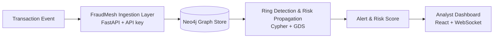

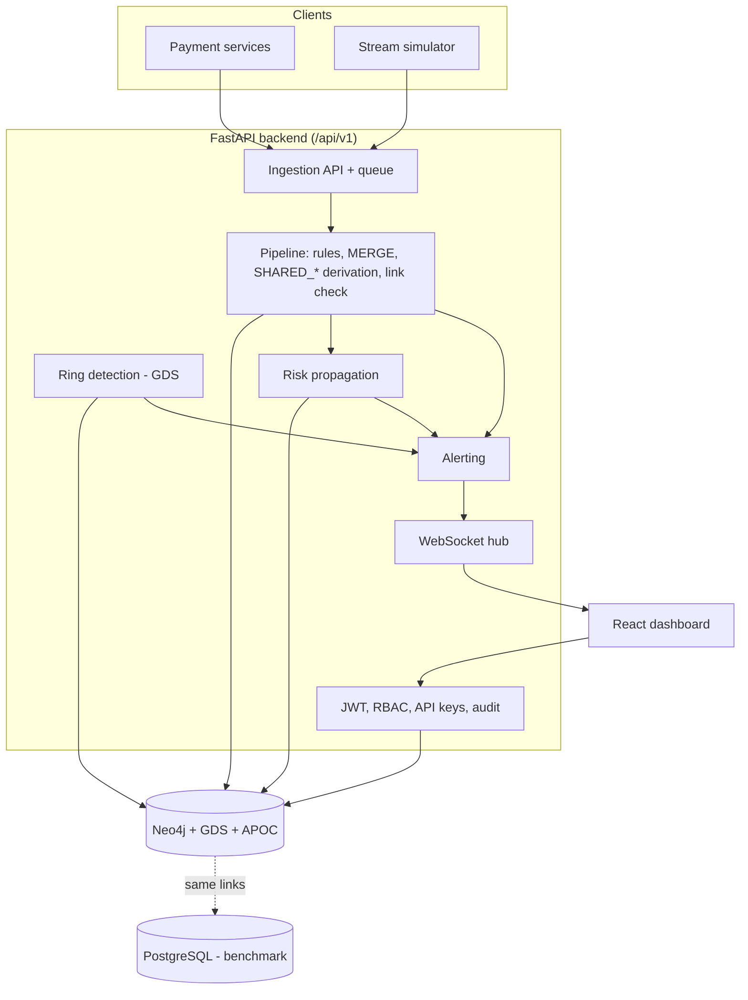

Detailed walk-through of one transaction, background jobs and design trade-offs: [docs/architecture.md](docs/architecture.md).

---

## 7. Graph Data Model

Full description with conventions and a worked example: [docs/data-model.md](docs/data-model.md). Schema: [backend/schema.cypher](backend/schema.cypher). Typed definitions: [backend/app/models/graph.py](backend/app/models/graph.py).

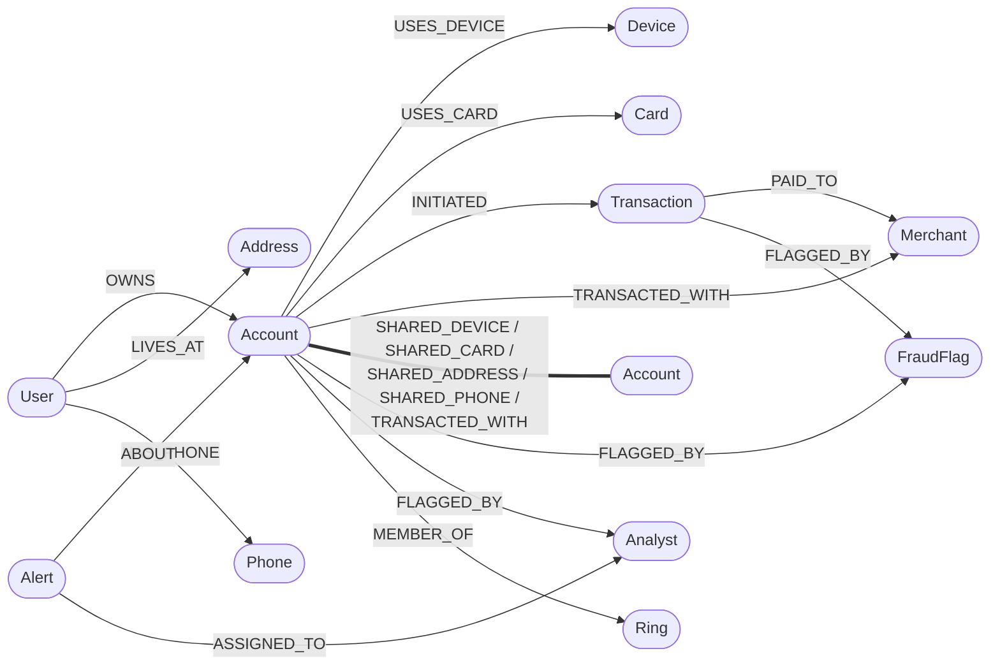

Rendered diagram: [docs/data-model.svg](docs/data-model.svg).

### Node labels

| Label | Key properties | Unique key |
|---|---|---|
| `User` | id, name, email, phone (masked), created_at, kyc_status | `id` |
| `Account` | id, account_no, type, status, opened_at, risk_score, propagated_risk, combined_risk, risk_explanation, pre_emptive, is_flagged, component_id, community_id, hub_score | `id`, `account_no` |
| `Device` | device_id, fingerprint, os, ip_last_seen | `device_id` |
| `Card` | card_hash (HMAC-SHA256), last4, bin, issuer, type. Raw numbers never stored. | `card_hash` |
| `Address` | id, line, city, pincode, normalized_hash | `id`, `normalized_hash` |
| `Phone` | number_hash | `number_hash` |
| `Merchant` | id, name, category, mcc, country, risk_tier | `id` |
| `Transaction` | id, amount, currency, timestamp, channel, location, status, rule_score, rule_reasons, final_score, decision | `id` |
| `FraudFlag` | id, source (`RULE`/`RING`/`PROPAGATION`), reason, confidence, created_at | `id` |
| `Analyst` | id, username, name, role, active, password_hash | `id`, `username` |
| `Ring` | ring_id, algorithm, size, avg_risk, density, new_account_ratio, flagged_members, hub_account, shared_* counts, total_volume, detected_at, status | `ring_id` |
| `Alert` | id, type, severity, explanation, created_at, status, notes, entity_label, entity_id | `id` |
| `ApiKey`, `AuditLog`, `Config` | platform nodes (keys, audit trail, runtime settings) | `id` |

### Relationship types

| Relationship | Direction | Properties | Purpose |
|---|---|---|---|
| `TRANSACTED_WITH` | Account → Account / Merchant | count, total_amount, last_at | Money flow |
| `SHARED_DEVICE` | Account – Account (derived) | device_id, since | Same device |
| `SHARED_ADDRESS` | Account – Account (derived) | address_id, since | Owners at the same address |
| `SHARED_CARD` | Account – Account (derived) | card_hash, since | Same card |
| `SHARED_PHONE` | Account – Account (derived) | number_hash, since | Owners with the same phone |
| `FLAGGED_BY` | Account / Transaction → FraudFlag (automated) or Analyst (manual) | reason, at, confidence | Marked as fraud |
| `OWNS`, `USES_DEVICE`, `USES_CARD`, `LIVES_AT`, `HAS_PHONE`, `INITIATED`, `PAID_TO`, `MEMBER_OF` | various | — | Supporting structure |
| `ABOUT`, `ASSIGNED_TO` | Alert → subject / Analyst | — | Alert links |

**Constraints and indexes:** 19 uniqueness constraints and 15 range indexes, applied automatically at startup; `/ready` verifies all 34 exist.

---

## 8. Feature Traceability

| # | Feature | Implementation | API endpoint(s) | Dashboard page | Status |
|---|---|---|---|---|---|
| F1 | Graph data model | `backend/schema.cypher`, `app/models/graph.py`, `app/db/schema.py`, `docs/data-model.md` | `/ready` (schema check) | — | ✅ Done |
| F2 | Real-time ingestion | `app/services/ingestion.py`, `app/api/v1/ingest.py`, `app/cypher/derive_shared_edges_for_account.cypher` | `POST /api/v1/ingest/transaction`, `/ingest/batch` | Overview (live feed) | ✅ Done |
| F3 | Rule-based baseline | `app/services/rules.py`, `backend/rules.yaml`, `app/datagen/scoring.py` | (part of ingestion), `PUT /admin/settings` | Rules vs Graph, Admin | ✅ Done |
| F4 | Multi-hop Cypher discovery | `app/cypher/*.cypher`, `app/services/graph_queries.py` | `/graph/neighbourhood`, `/graph/shortest-path`, `/graph/shared`, `/graph/linked-to-fraud`, `/graph/search` | Graph Explorer, Path Finder | ✅ Done |
| F5 | GDS ring detection | `app/services/ring_detection.py`, `app/workers/scheduler.py` | `POST /api/v1/rings/detect?algorithm=louvain\|lpa` | Rings | ✅ Done |
| F6 | Ring management | `app/api/v1/rings.py`, `app/services/flagging.py` | `GET /rings`, `GET /rings/{id}`, `PATCH /rings/{id}/status` | Rings (detail + review) | ✅ Done |
| F7 | Risk propagation | `app/services/propagation.py` | `POST /risk/propagate/{id}`, `/risk/recompute`, `/risk/accounts`, `/risk/spread/{id}` | Risk Propagation | ✅ Done |
| F8 | Alerts + WebSocket | `app/services/alerting.py`, `app/websocket/`, `app/api/v1/alerts.py` | `GET/PATCH /alerts`, `WS /ws` | Alerts, Overview | ✅ Done |
| F9 | Analyst dashboard (11 pages) | `frontend/src/` | — | Login, Overview, Rings, Graph Explorer, Path Finder, Risk Propagation, Alerts, Rules vs Graph, Performance, Admin, Audit Log | ✅ Done |
| F10 | Synthetic data, simulator, evaluation | `app/datagen/`, `app/seed.py`, `app/simulator.py`, `app/evaluation.py`, `scripts/` | — | Rules vs Graph | ✅ Done |
| F11 | Graph vs relational benchmark | `app/benchmark.py`, `docs/benchmark.png` | `GET /stats/benchmark` | Performance | ✅ Done |
| F12 | Backend security | `app/security/` | `/auth/*`, `/admin/*` | Login, Admin, Audit Log | ✅ Done |
| F13 | Reusable, decoupled API | `app/api/v1/ingest.py`, `examples/payment_service_client.py` | `POST /api/v1/score` | — | ✅ Done |
| F14 | Observability and health | `app/api/health.py`, `app/services/metrics.py`, `app/logging_config.py` | `/health`, `/ready`, `/stats/metrics` | Overview, Performance | ✅ Done |

---

## 9. Tech Stack

| Layer | Technology |
|---|---|
| Graph database | Neo4j 5.26 Community with **Graph Data Science 2.13** and **APOC** |
| Backend | Python 3.12, FastAPI, official `neo4j` async driver, Pydantic v2 |
| Real-time | FastAPI WebSockets; `asyncio` queue and scheduler |
| Frontend | React 18 + Vite + TypeScript, Tailwind CSS 4, Cytoscape.js (graphs), Recharts (charts) |
| Security | PyJWT (access + refresh), bcrypt, RBAC, hashed API keys, slowapi rate limiting, HMAC-SHA256 PII hashing |
| Relational baseline | PostgreSQL 16 (benchmark only), psycopg 3 |
| Data | Faker (`en_IN`) |
| Testing | pytest + testcontainers (real Neo4j with GDS/APOC), Vitest + React Testing Library |
| Packaging | Docker Compose |

---

## 10. Getting Started

### Prerequisites

- [Docker Desktop](https://www.docker.com/products/docker-desktop/) (or Docker Engine + Compose v2), **running**
- Git
- Internet access on the first start (Neo4j downloads the GDS and APOC plugins)
- For running tests locally: Python 3.11+ and Node.js 20+

### Run it

```bash
git clone <repo-url>
cd NOSQL-Project

# 1. Configuration: copy, then change the passwords and the two secrets
cp .env.example .env
#    PII_HASH_KEY and JWT_SECRET: generate with
#    python -c "import secrets; print(secrets.token_hex(32))"

# 2. Start Neo4j, PostgreSQL, backend and frontend
docker compose up --build -d

# 3. Wait until ready (Neo4j becomes healthy after about a minute on first start)
curl http://localhost:8000/ready

# 4. Load demo data: 50,000 transactions with 24 planted rings, default users,
#    a simulator API key, then run propagation + ring detection (about 1-2 minutes)
docker compose exec backend python -m app.seed

# 5. Optional: evaluation and benchmark (results appear on the dashboard)
docker compose exec backend python -m app.evaluation
docker compose exec backend python -m app.benchmark
```

| Service | URL | Login |
|---|---|---|
| Dashboard | http://localhost:5173 | `admin`, `analyst` or `viewer` / `DEFAULT_ADMIN_PASSWORD` from `.env` (default `ChangeMe123!`) |
| API docs (Swagger) | http://localhost:8000/docs | — |
| Neo4j Browser | http://localhost:7474 | `NEO4J_USER` / `NEO4J_PASSWORD` from `.env` |

On Linux/macOS the `Makefile` has shortcuts: `make up`, `make seed`, `make simulate`, `make evaluate`, `make benchmark`, `make test`, `make down`, `make clean`. On Windows, run the `docker compose ...` commands shown above.

Stop with `docker compose down` (keeps data) or `docker compose down -v` (deletes all data).

---

## 11. Usage Guide

| Task | How |
|---|---|
| **Stream live transactions** | `docker compose exec backend python -m app.simulator --rate 10 --fraud-every 20`. Every 20 s a new account appears on a device used by a planted ring. |
| **Watch the live feed** | **Overview**: KPIs, live transaction feed with decisions, alert and risk charts, latency. |
| **View rings** | **Rings** lists detected rings (filter by status). Click one for its graph, members and hub account. *Run detection now* re-runs GDS with Louvain or LPA. |
| **Confirm a ring** | On a ring page (ANALYST): *Start review* → *Confirm fraud*. All members are flagged and their risk propagates; the result shows how many accounts were reached. |
| **Watch risk propagate** | **Risk Propagation**: click a flagged account; the graph reveals reached accounts hop by hop, the table shows each score and the path that explains it. *Flag & propagate* flags any account by hand. |
| **Find how two accounts are linked** | **Path Finder**: enter two account IDs → shortest path as a graph and as text (`A -[USES_DEVICE]- Device D -[USES_DEVICE]- B`). |
| **Explore** | **Graph Explorer**: search an account, device, card (last 4), person, merchant or address; choose depth and relationship types; expand nodes. |
| **Handle alerts** | **Alerts**: live list; *Manage* → acknowledge, assign to me, add a note, resolve. |
| **Compare with rules** | **Rules vs Graph**: accounts caught by rules only / graph only / both, plus precision, recall, F1 against ground truth. |
| **Tune** | **Admin** (ADMIN): users and roles, API keys, rule thresholds, propagation weights/decay/depth, detection algorithm and schedule, decision thresholds. |
| **Use from another service** | `python examples/payment_service_client.py --account A000010` (see [F13](docs/architecture.md#decoupling-f13)). |

A 5-minute demo script for the viva: [docs/demo-script.md](docs/demo-script.md).

---

## 12. API Reference (summary)

Full reference with request/response examples: [docs/api.md](docs/api.md). Interactive: http://localhost:8000/docs.

| Method | Path | Role | Description |
|---|---|---|---|
| GET | `/health`, `/ready` | public | Liveness; Neo4j + GDS + APOC + schema readiness |
| POST | `/api/v1/auth/login`, `/auth/refresh` | public | JWT access + refresh tokens |
| POST | `/api/v1/ingest/transaction`, `/ingest/batch` | API key | Queue transaction events |
| POST | `/api/v1/score` | API key | Synchronous ALLOW / REVIEW / BLOCK with explanation |
| GET | `/api/v1/graph/neighbourhood/{key}?depth=1..6` | VIEWER | Everything within N hops |
| GET | `/api/v1/graph/shortest-path?from=A&to=B` | VIEWER | How two accounts are linked |
| GET | `/api/v1/graph/shared/{id}?min_shared=K` | VIEWER | Accounts sharing ≥ K attributes |
| GET | `/api/v1/graph/linked-to-fraud/{id}?depth=N` | VIEWER | Paths to the nearest flagged accounts |
| POST | `/api/v1/rings/detect?algorithm=louvain\|lpa` | ANALYST | Run ring detection |
| GET | `/api/v1/rings`, `/rings/{id}` | VIEWER | List / detail with subgraph |
| PATCH | `/api/v1/rings/{id}/status` | ANALYST | Review workflow; confirming flags members and propagates |
| POST | `/api/v1/risk/propagate/{id}` | ANALYST | Flag an account and propagate |
| GET | `/api/v1/risk/spread/{id}` | VIEWER | How risk spread from an account |
| GET/PATCH | `/api/v1/alerts`, `/alerts/{id}` | VIEWER / ANALYST | List; acknowledge, assign, note, resolve |
| GET | `/api/v1/stats/overview`, `/comparison`, `/benchmark`, `/metrics` | VIEWER | Dashboard data |
| * | `/api/v1/admin/users`, `/api-keys`, `/settings`, `/audit` | ADMIN | Administration |
| WS | `/ws?token=` | VIEWER | Live alerts and transactions |

---

## 13. Key Cypher Queries

All queries with explanations: [docs/cypher-queries.md](docs/cypher-queries.md). Three of the most important:

**Derive shared-device links** (one edge per shared device, lower id → higher id, same owner excluded):
```cypher
MATCH (a1:Account)-[:USES_DEVICE]->(d:Device)<-[:USES_DEVICE]-(a2:Account)
WHERE a1.id < a2.id AND NOT EXISTS { (a1)<-[:OWNS]-(:User)-[:OWNS]->(a2) }
MERGE (a1)-[r:SHARED_DEVICE {device_id: d.device_id}]->(a2)
  ON CREATE SET r.since = datetime();
```

**How are two accounts linked?** (raw attribute links, so the answer names the shared thing):
```cypher
MATCH (a:Account {id: $from}), (b:Account {id: $to})
MATCH p = shortestPath((a)-[:OWNS|USES_DEVICE|USES_CARD|LIVES_AT|HAS_PHONE|TRANSACTED_WITH*..10]-(b))
WHERE none(n IN nodes(p) WHERE n:Merchant)
RETURN p
```

**Risk propagation paths** (every path of up to 3 hops from known fraud):
```cypher
MATCH (s:Account {is_flagged: true})
MATCH p = (s)-[:SHARED_DEVICE|SHARED_CARD|SHARED_ADDRESS|SHARED_PHONE|TRANSACTED_WITH*1..3]-(t:Account)
WHERE t <> s AND all(n IN nodes(p) WHERE n:Account)
RETURN s.id AS source, t.id AS target, [r IN relationships(p) | type(r)] AS types, [n IN nodes(p) | n.id] AS ids
```

---

## 14. Algorithms

Full explanation with formulas and worked examples: [docs/algorithms.md](docs/algorithms.md).

- **Rule baseline:** high amount (40), velocity (30), new device (15), foreign location (25), high-risk merchant (30); capped at 100; ≥ 60 counts as caught.
- **Ring detection:** GDS projection of account links (weighted, undirected) → **WCC** over identity links (`SHARED_*`) groups accounts tied by devices/cards/addresses/phones; small groups (≤ 30) are candidates → **Louvain or Label Propagation** splits larger groups → **PageRank** picks the hub.
- **Suspicion criteria:** size ≥ 3 AND (contains a flagged account OR (density ≥ 0.5 AND ≥ 50% of accounts opened in the last 90 days)).
- **Risk propagation:** `contribution = source_risk × Π(weights) × 0.5^hops`, up to 3 hops; weights device 0.9, card 0.9, phone 0.8, address 0.6, transfer 0.4; strongest path per source; sources combined with **noisy-OR** `1 − Π(1 − cᵢ)`. Example: A → B via device = 1.0 × 0.9 × 0.5 = **0.45**; → C via address = **0.135**; → D via transfer = **0.027**.
- **Pre-emptive detection:** propagated risk ≥ 0.3, not flagged, no transaction ever scored ≥ 60 by rules.
- **Decision:** `final = 100 × (1 − (1 − rule/100)(1 − graph_risk))`; < 40 ALLOW, < 70 REVIEW, else BLOCK.

---

## 15. Security

| Measure | Implementation |
|---|---|
| Authentication | JWT access tokens (15 min) + refresh tokens (7 days), HS256; token `type` claim prevents misuse ([security/jwt.py](backend/app/security/jwt.py)) |
| Passwords | bcrypt ([security/passwords.py](backend/app/security/passwords.py)) |
| Authorisation | RBAC `ADMIN > ANALYST > VIEWER` enforced on every endpoint ([security/rbac.py](backend/app/security/rbac.py)); the dashboard also hides what a role cannot use |
| Service access | API keys `fm_…`, stored only as SHA-256, revocable, per-key per-minute rate limit ([security/api_keys.py](backend/app/security/api_keys.py)) |
| Rate limiting | Login 10/min and refresh 30/min per IP (slowapi); ingestion per API key (batches count each event) |
| Injection safety | Every user value is a Cypher `$parameter`; labels, relationship types and depths come from whitelists |
| Input validation | Pydantic models for every request (formats, ranges, exactly-one-payee rule) |
| PII protection | Card and phone numbers hashed with HMAC-SHA256 (secret `PII_HASH_KEY`) on arrival; UI shows `Card ****1234`, `******4321`; addresses normalised before hashing |
| Transport/browser | CORS limited to the dashboard origin; `X-Content-Type-Options`, `X-Frame-Options`, `Referrer-Policy`, `Permissions-Policy` headers |
| Audit log | Every login, flag, ring decision, alert change, setting change, user and key change is an `:AuditLog` node (Audit Log page) |
| Secrets | Only via environment variables; `.env` is git-ignored; containers run as non-root |
| Least-privilege DB user | Requires Neo4j Enterprise (fine-grained roles); on Community the app uses the default user. See Limitations. |

---

## 16. Results

All numbers below were produced by the commands in [Getting Started](#10-getting-started) on a laptop (Windows 11, Docker Desktop), with the default seed (42).

### Detection quality (`python -m app.evaluation`)

Ground truth: 24 planted rings (6 each of shared-device, shared-address mule, card-testing and layering-chain), 125 ring accounts. The 17 accounts flagged in the seed data are already-known fraud and are excluded, leaving **108 hidden fraud accounts** among 7,000.

| Approach | Precision | Recall | F1 | TP | FP | FN |
|---|---|---|---|---|---|---|
| Rules only (baseline) | 0.667 | 0.056 | 0.103 | 6 | 3 | 102 |
| Graph ring detection | 0.857 | **1.000** | **0.923** | 108 | 18 | 0 |
| Graph + propagation | 0.857 | 1.000 | 0.923 | 108 | 18 | 0 |

- **Planted rings found: 24 / 24** (every type 6/6).
- The 18 false positives are ordinary families with several newly opened accounts sharing an address or device; an analyst would mark those rings *False positive*.
- Propagation adds no accounts *beyond* ring detection here because every propagated-risk account in this dataset is also inside a detected ring; its value shows in the live system, where it flags **49 pre-emptive detections at seed time** and new accounts that appear on ring devices (see the simulator), before ring detection runs.

### Latency

Measured by the backend (`/api/v1/stats/metrics`) while streaming 5–10 transactions/s: **p50 ≈ 65 ms, p95 ≈ 140 ms** from event to decision, including the graph write, SHARED_* derivation, rule scoring and alerts. Events that link an account to known fraud also run a full risk propagation and take up to ≈ 700 ms. All within the 1-second target.

### Graph vs relational benchmark (`python -m app.benchmark`)

Same 8,369 account-to-account links in both databases (PostgreSQL: indexed `shared_link(a, b, kind)` table, recursive CTE; Neo4j: APOC breadth-first traversal). Mean of 20 start accounts × 3 runs; both databases must return identical counts. *Client* = measured from Python, including one network round trip; *server* = the database's own execution time.

**Shared attributes only** (identity graph: small clusters)

| Depth | Neo4j client ms | PostgreSQL client ms | Neo4j server ms | PostgreSQL server ms | Accounts reached |
|---|---|---|---|---|---|
| 1 | 5.84 | 0.87 | 1.55 | 0.28 | 1.9 |
| 2 | 3.41 | 0.55 | 0.85 | 0.31 | 2.0 |
| 3 | 3.28 | 0.56 | 0.45 | 0.22 | 2.1 |
| 4 | 3.26 | 0.60 | 0.65 | 0.24 | 2.3 |
| 5 | 2.98 | 0.62 | 0.70 | 0.24 | 2.4 |
| 6 | 3.06 | 0.75 | 0.50 | 0.29 | 2.5 |

**Shared attributes + money transfers** (one large network)

| Depth | Neo4j client ms | PostgreSQL client ms | Neo4j server ms | PostgreSQL server ms | Accounts reached |
|---|---|---|---|---|---|
| 1 | 3.35 | 0.65 | 0.55 | 0.21 | 3.6 |
| 2 | 3.37 | 0.62 | 0.70 | 0.26 | 11.1 |
| 3 | 3.38 | 0.74 | 0.75 | 0.35 | 27.6 |
| 4 | 3.93 | 0.93 | 1.20 | 0.62 | 64.4 |
| 5 | 4.65 | 1.55 | 1.75 | 1.19 | 148.8 |
| 6 | 8.01 | 3.09 | 3.90 | 3.09 | 331.2 |

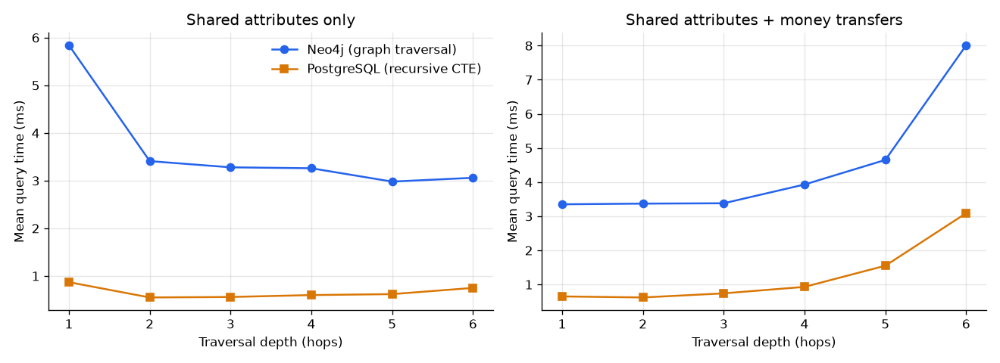

**Reading the results honestly:** at this data size **PostgreSQL is faster** in absolute terms. The link table is small (≈ 17k rows) and fits in memory, so each recursive step is a cheap index lookup, while each Neo4j call carries a fixed overhead of about 2–3 ms (Bolt round trip and procedure call). The gap narrows as depth grows: on the full network PostgreSQL's server time rises 15× from depth 1 to 6 (0.21 → 3.09 ms) while Neo4j's rises 7× (0.55 → 3.90 ms), and at depth 6 the two engines are within about 1 ms of each other. We did not observe Neo4j overtaking PostgreSQL at 7,000 accounts; demonstrating that would need a much larger graph than this project generates. The graph's clearer advantage in FraudMesh is expressiveness: ring detection, propagation and path explanation are a few Cypher/GDS calls instead of hand-written recursive SQL.

---

## 17. Screenshots

| | |
|---|---|
| **Login** 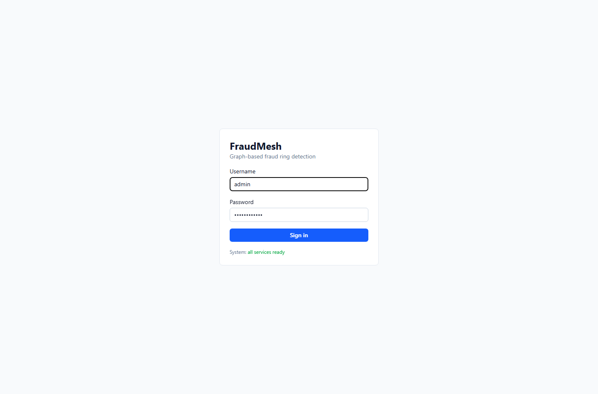 | **Overview** 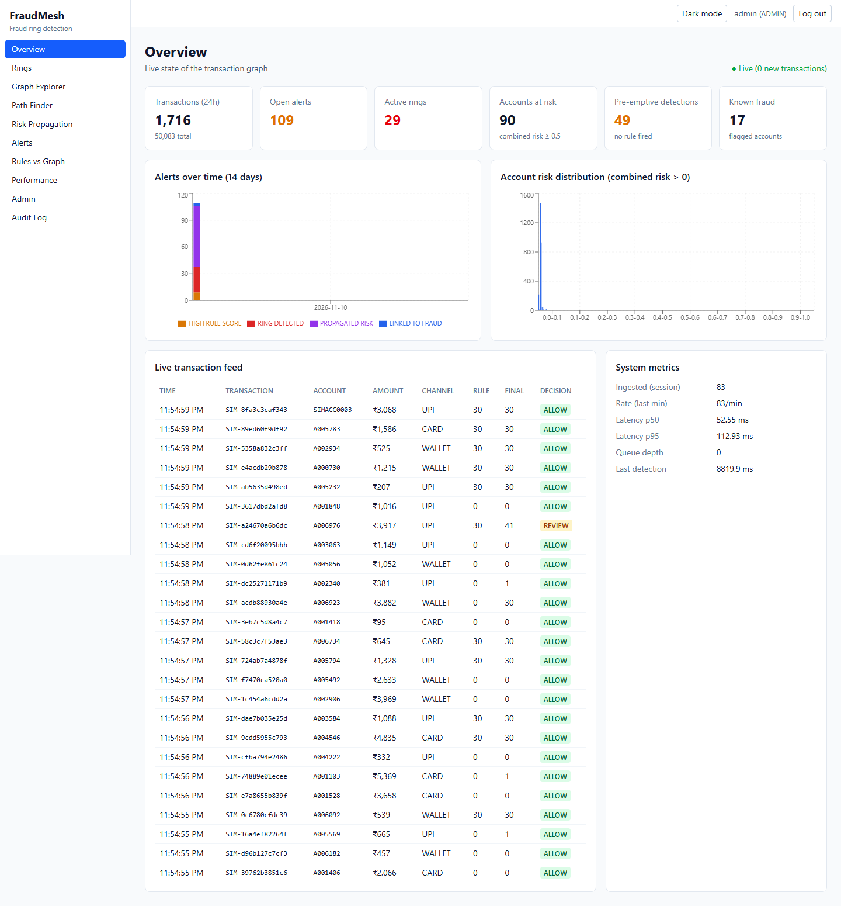 |
| **Rings** 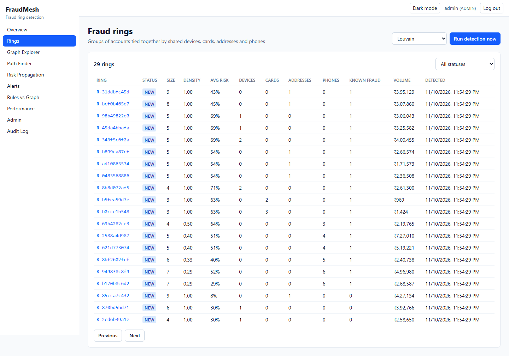 | **Ring detail** 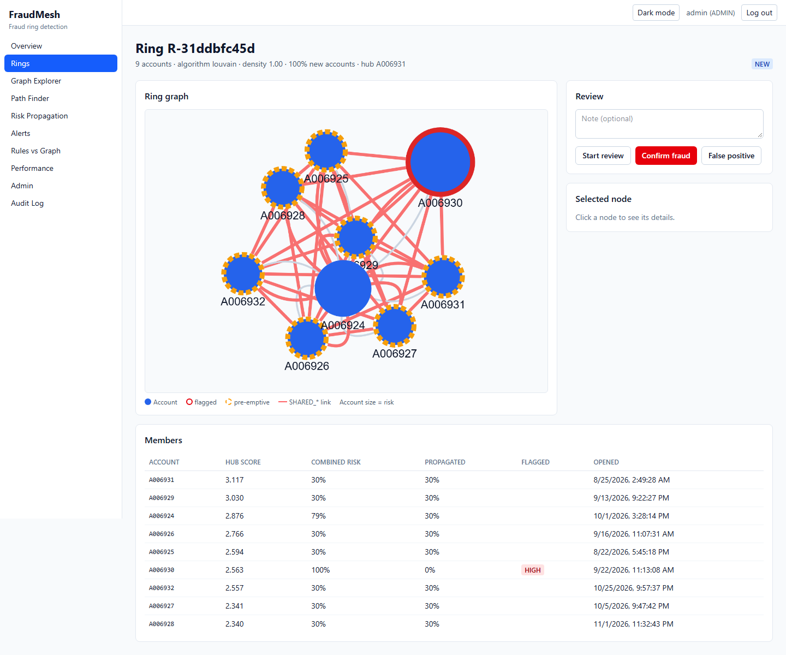 |
| **Graph Explorer** 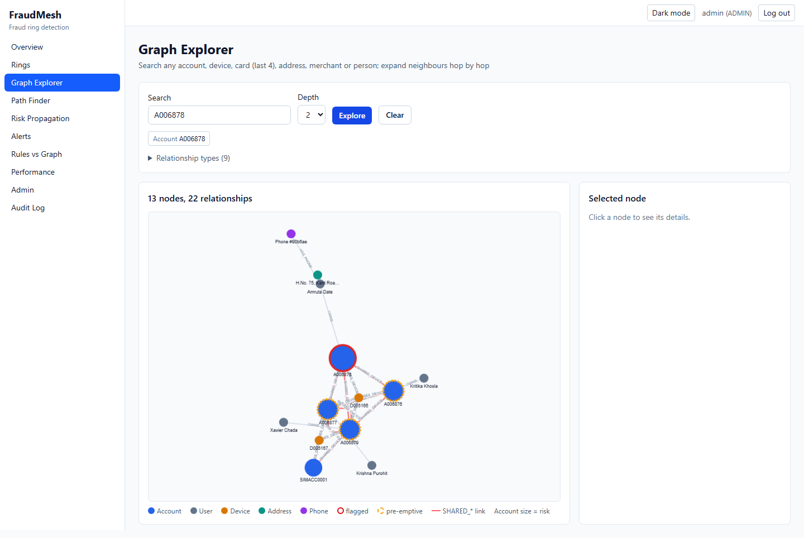 | **Path Finder** 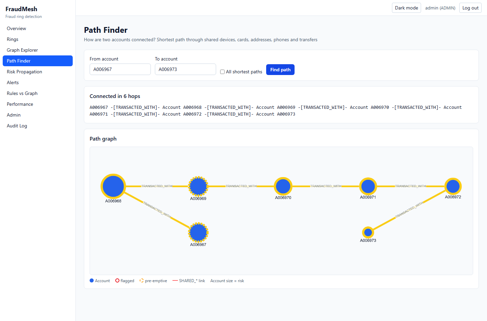 |
| **Risk Propagation** 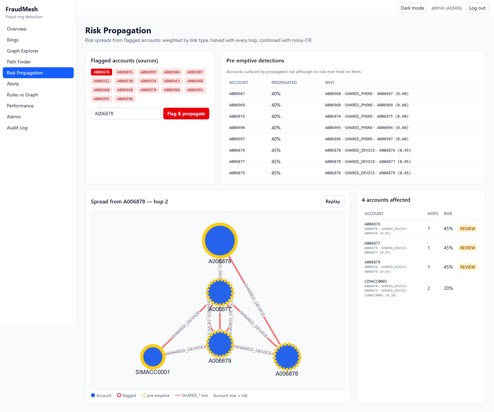 | **Alerts** 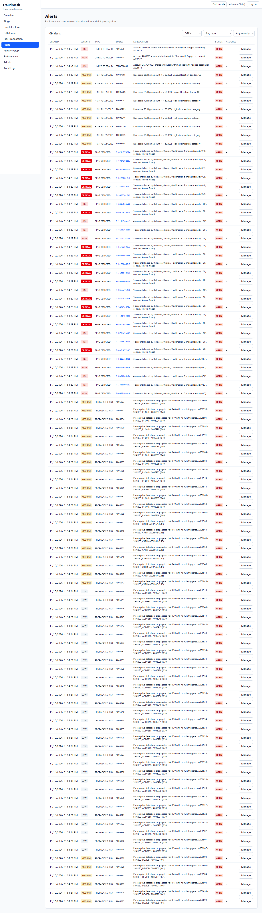 |
| **Rules vs Graph** 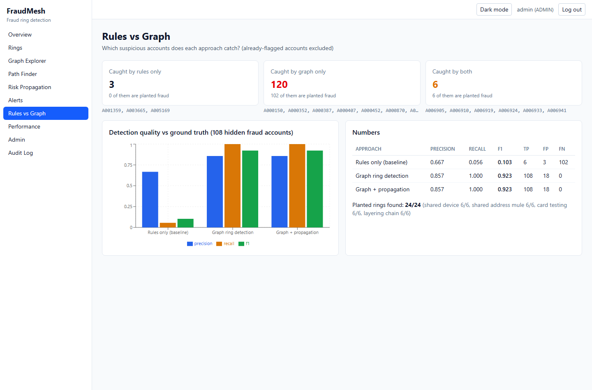 | **Performance** 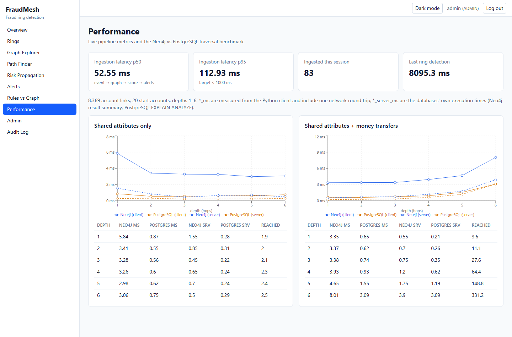 |
| **Admin** 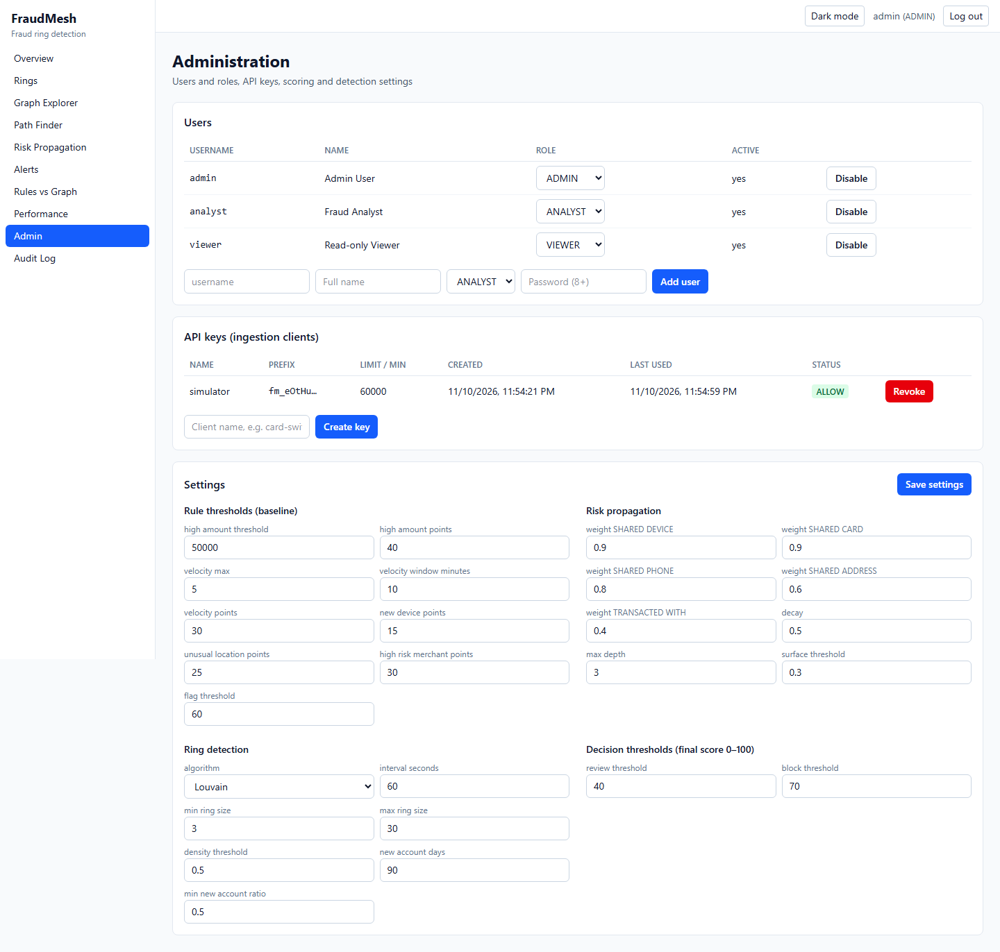 | **Audit Log** 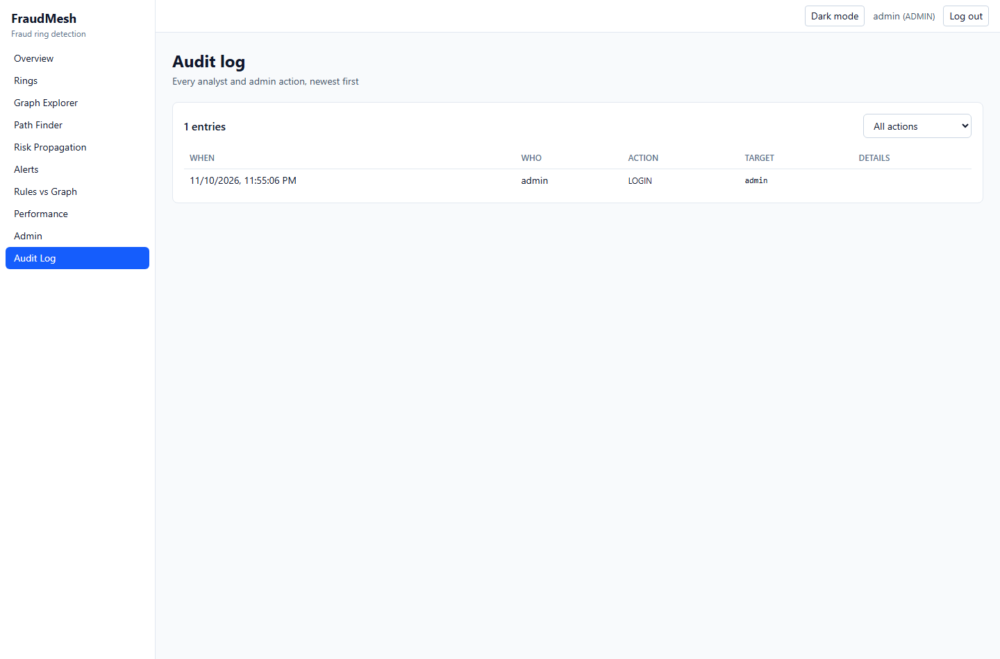 |
| **Overview, dark mode** 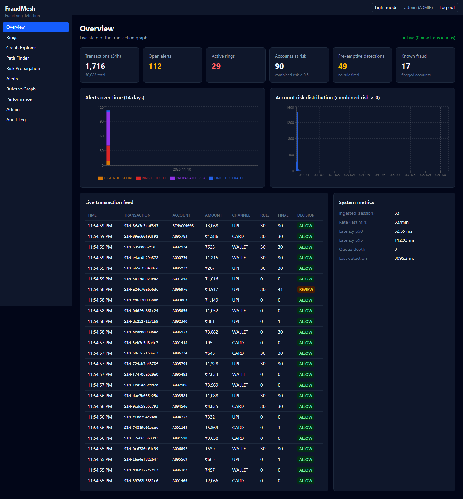 | |

---

## 18. Testing

```bash
# Backend (integration tests start throwaway Neo4j containers with GDS + APOC: Docker must be running)
cd backend
python -m venv .venv
# Windows: .venv\Scripts\activate    Linux/macOS: source .venv/bin/activate
pip install -r requirements-dev.txt
pytest --cov=app --cov-report=term-missing   # everything
pytest -m "not integration"                  # unit tests only, no Docker needed

# Frontend
cd frontend
npm install
npm test
```

`make test` runs both on Linux/macOS.

**Current status: 103 backend tests and 12 frontend tests pass. Backend coverage: 73%.**

| Suite | Tests | What it checks |
|---|---|---|
| `test_rules.py` | 15 | Every rule's points, velocity boundary, cap at 100, rules.yaml loads, location rule, final-score formula, ALLOW/REVIEW/BLOCK thresholds |
| `test_propagation.py` | 7 | The 3-hop worked example (0.45 / 0.135 / 0.027), noisy-OR, strongest path per source, no self-propagation, combined risk |
| `test_ring_criteria.py` | 9 | Density, parallel edges, suspicion criteria (families vs rings), stable ring IDs, overlap |
| `test_security.py` | 12 | bcrypt, JWT round trip / expiry / tampering / type, role hierarchy, 401 without login, 403 per role, API key required, depth validation, security headers, rate-limit window |
| `test_events.py` | 6 | Event validation (exactly one payee, formats), bulk rule scoring catches card-testing velocity |
| `test_datagen.py`, `test_pii.py`, `test_models.py`, `test_schema.py`, `test_health.py` | 38 | Generator totals, determinism, every ring type wired correctly, PII hashing/normalisation, model rules, schema loader, readiness |
| `integration/test_schema_neo4j.py` | 4 | All constraints/indexes created, idempotent, duplicate IDs rejected |
| `integration/test_datagen_neo4j.py` | 6 | Bulk load counts, idempotent reload, every ring type produces SHARED_* edges, no same-owner edges |
| `integration/test_pipeline_neo4j.py` | 6 | **Ring detection finds every planted ring**, GDS projection dropped, **propagation reaches ring members with ≥ 0.45**, shortest path names the device, neighbourhood + link-to-fraud, **ingestion is idempotent and links a new account to a ring with LINKED_TO_FRAUD and PROPAGATED_RISK alerts** |
| `frontend/src/test/pages.test.tsx` | 12 | Every dashboard page renders with a mocked API; viewers cannot see admin pages |

Nothing is excluded from coverage; the uncovered 27% is mostly the command-line tools (`seed`, `simulator`, `benchmark`, `evaluation`), which were run end to end against the live stack instead.

---

## 19. Project Structure

```
├── README.md, CHANGELOG.md, FraudMesh-Master-Prompt.md
├── docker-compose.yml           Neo4j + GDS + APOC, PostgreSQL, backend, frontend
├── .env.example                 all configuration (copy to .env)
├── Makefile                     shortcuts (up, seed, simulate, evaluate, benchmark, test ...)
├── backend/
│   ├── app/
│   │   ├── main.py              FastAPI app: lifespan, CORS, security headers, routers
│   │   ├── config.py            settings from environment variables
│   │   ├── api/health.py        /health, /ready
│   │   ├── api/v1/              auth, ingest (+score), graph, rings, risk, alerts, stats, admin
│   │   ├── cypher/              commented .cypher query files
│   │   ├── db/                  Neo4j driver, schema loader, JSON serialisation
│   │   ├── models/              graph model, events, runtime settings
│   │   ├── services/            ingestion, rules, graph_queries, ring_detection, propagation,
│   │   │                        alerting, flagging, metrics, settings_store
│   │   ├── security/            jwt, passwords, rbac, api_keys, rate_limit, audit, pii
│   │   ├── workers/scheduler.py periodic detection + propagation
│   │   ├── websocket/           live event hub + /ws
│   │   ├── datagen/             synthetic data: builder, ring planters, loader, bulk scoring
│   │   ├── seed.py              one-command demo setup
│   │   ├── simulator.py         live transaction stream
│   │   ├── evaluation.py        precision / recall / F1 vs ground truth
│   │   └── benchmark.py         Neo4j vs PostgreSQL
│   ├── schema.cypher            19 constraints + 15 indexes
│   ├── rules.yaml               baseline rule thresholds
│   ├── tests/                   unit tests + integration/ (real Neo4j)
│   └── Dockerfile
├── frontend/src/
│   ├── pages/                   11 pages
│   ├── components/              Layout, GraphView (Cytoscape), UI primitives
│   ├── hooks/                   useApi, useLive (WebSocket)
│   ├── api/, auth/, test/
├── scripts/                     host wrappers: generate_data, seed_admin, simulate_stream, evaluate, benchmark
├── examples/payment_service_client.py
├── data/                        generated: ground_truth.json, evaluation.json, benchmark.json, simulator_api_key.txt
└── docs/                        architecture, data-model, algorithms, api, cypher-queries, demo-script,
                                 benchmark.png, screenshots/
```

---

## 20. Design Decisions and Assumptions

**Data model**
- **Neo4j as the core store**: fraud rings are a relationship problem; the graph follows links directly instead of joining at query time.
- **Derived `SHARED_*` edges**, one per shared attribute, stored lower id → higher id and queried undirected; accounts of the same owner are not linked.
- **Address and phone hang off the User; device and card off the Account**, matching how they exist in reality.
- **`FLAGGED_BY` target depends on who flagged**: automated (rule, ring confirmation) → `FraudFlag` node; manual → the `Analyst`.
- **Required properties enforced by Pydantic**, because Neo4j Community has no existence constraints.
- **Two score scales**: transaction scores 0–100 (as the spec defines `rule_score`); account risks 0–1 (noisy-OR needs probabilities).
- **Dashboard users are `:Analyst` nodes**, so the same node is both the login identity and the target of manual flags and alert assignments.

**Detection**
- **WCC on identity links before community detection.** Running Louvain on all links let ring members' ordinary money transfers pull them into large communities of normal customers (measured: 0/6 mule rings, 0/6 layering chains found). WCC first, then Louvain/LPA only for groups larger than 30, finds 24/24.
- **New-account condition in the suspicion criteria.** Density alone also flagged ordinary families sharing an address (precision 0.21); requiring most accounts to be under 90 days old raised precision to 0.86 without losing any planted ring.
- **Stable ring IDs** (hash of members) so re-detection updates rather than duplicates; analyst-reviewed rings are never overwritten.
- **Unique GDS projection name per run**, dropped in `finally`, so scheduled and on-demand runs cannot collide or leak memory.
- **APOC breadth-first traversal for neighbourhoods and benchmark**, because plain variable-length patterns enumerate every path and explode inside dense rings.

**Scoring**
- **Full propagation recompute** instead of incremental updates: keeps noisy-OR exact (each source counted once) and is fast at this scale (< 1 s).
- **Strongest path per (source, target)**: parallel paths from one fraudster are one piece of evidence.
- **Final score uses graph risk, not the account's own rule history**, so one rule hit is not counted twice.
- **Unusual location = outside India.** An earlier city-based rule flagged every simulated purchase made away from the customer's home city.

**Platform**
- **Neo4j 5.26 Community (LTS)** with plugins installed by the official image (`NEO4J_PLUGINS`), avoiding version mismatches.
- **`asyncio` queue and scheduler** instead of Redis Streams and APScheduler: one process is enough here and the stack stays small. Trade-off: queued events are lost on restart.
- **One lock** serialises ingestion, scheduled runs and risk-rewriting analyst actions.
- **HMAC-SHA256 for PII** instead of plain SHA-256: card and phone numbers have small search spaces, so an unkeyed hash could be reversed by brute force.
- **Tokens in `sessionStorage`** (cleared when the tab closes), mirrored in memory; WebSocket authenticates with `?token=` because browsers cannot set WebSocket headers.
- **Vite dev server** serves the dashboard in Docker: one simple container with hot reload for development and demos.
- **Synthetic data with ground truth**: real financial data is not available; planted rings make evaluation measurable. Benign sharing (3% of customers share an address, 2% share a device) is generated on purpose so that shared attributes alone are not proof.

---

## 21. Limitations and Future Work

- **Synthetic data.** Results come from generated data with planted rings; real fraud is messier. The new-account criterion matches how the generator builds rings and real synthetic-identity fraud, but should be validated on real data.
- **Benchmark scale.** At 7,000 accounts PostgreSQL is faster; a meaningful native-graph comparison needs millions of accounts and longer traversals.
- **Least-privilege Neo4j user** needs Enterprise Edition (fine-grained roles). Community runs with the default user.
- **In-memory queue.** Queued, unprocessed events are lost if the backend restarts. Redis Streams or Kafka would add durability.
- **Single backend instance.** Rate-limit counters and the WebSocket hub are per process; scaling out would need shared state (e.g. Redis).
- **Global propagation recompute** is O(paths from all flagged accounts); with many flagged accounts it should become incremental or use GDS Pregel.
- **Hand-tuned weights and thresholds.** Future work: learn edge weights from labelled outcomes, or use graph neural networks (GraphSAGE) on the same graph.
- **No TLS in the Docker setup**; production would sit behind a TLS-terminating proxy.

---

## 22. Troubleshooting

| Problem | Fix |
|---|---|
| `failed to connect to the docker API ... dockerDesktopLinuxEngine` | Docker Desktop is not running. Start it and wait for "Engine running". |
| `Set NEO4J_PASSWORD in .env` | Create `.env`: `cp .env.example .env`. |
| Backend exits with a validation error about `JWT_SECRET` or `PII_HASH_KEY` | Both must be set in `.env` (JWT_SECRET ≥ 32 characters, PII_HASH_KEY ≥ 16). |
| Neo4j exits or never becomes healthy; log mentions password | The password must be at least 8 characters. It is stored in the data volume on first start, so changing `.env` later has no effect: `docker compose down -v` resets it (deletes data). |
| `/ready` shows `gds` or `apoc` unavailable | The plugin download failed on first start (no internet or a proxy). Check `docker compose logs neo4j` and restart with internet access. |
| `/ready` shows `schema` missing | The backend could not reach Neo4j at startup. `docker compose restart backend`. |
| Dashboard login says "Too many attempts" | Login is limited to 10 per minute per IP. Wait a minute. |
| Dashboard shows "Backend unreachable" | `docker compose ps`, `docker compose logs backend`; check `VITE_API_URL=http://localhost:8000` in `.env`. |
| Rules vs Graph or Performance say "No evaluation/benchmark yet" | Run `docker compose exec backend python -m app.evaluation` / `python -m app.benchmark`. |
| Simulator: `FileNotFoundError ... simulator_api_key.txt` | Run the seed first: `docker compose exec backend python -m app.seed`. |
| `port is already allocated` (7474, 7687, 5432, 8000, 5173) | Another program (often a local PostgreSQL or Neo4j Desktop) uses the port; stop it or change the left-hand port in `docker-compose.yml`. |
| Integration tests are skipped | Docker is not running; they need it to start Neo4j containers. The first run downloads the GDS/APOC plugins (≈ 1 minute). |
| `make: command not found` (Windows) | Use the `docker compose ...` commands from Getting Started. |

---

## 23. References

- Neo4j Documentation: https://neo4j.com/docs/
- Neo4j Graph Data Science Library (Louvain, Label Propagation, WCC, PageRank, Cypher projections): https://neo4j.com/docs/graph-data-science/current/
- APOC Path Expander procedures: https://neo4j.com/docs/apoc/current/graph-querying/expand-subgraph/
- Blondel, V. D., Guillaume, J.-L., Lambiotte, R., & Lefebvre, E. (2008). *Fast unfolding of communities in large networks.* Journal of Statistical Mechanics. (Louvain)
- Raghavan, U. N., Albert, R., & Kumara, S. (2007). *Near linear time algorithm to detect community structures in large-scale networks.* Physical Review E. (Label Propagation)
- Page, L., Brin, S., Motwani, R., & Winograd, T. (1999). *The PageRank Citation Ranking: Bringing Order to the Web.* Stanford InfoLab.
- Pearl, J. (1988). *Probabilistic Reasoning in Intelligent Systems.* Morgan Kaufmann. (noisy-OR)
- FastAPI: https://fastapi.tiangolo.com/ · Cytoscape.js: https://js.cytoscape.org/

---

## 24. License and Acknowledgements

Released under the MIT License for academic use.

Built as an academic project for CSAEC59: AEC-NoSQL at Ramaiah Institute of Technology, under the guidance of **Akshatha Kamath**.
