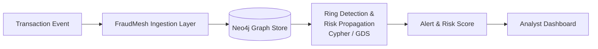
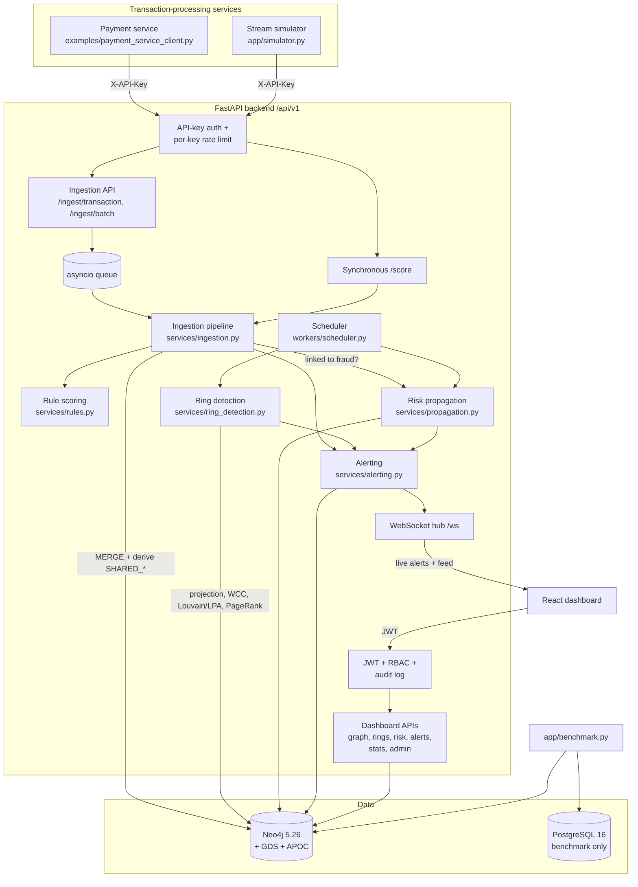

# FraudMesh Architecture

## End-to-end flow

## Components

## Request path of one transaction

1. A payment service sends the event to `POST /api/v1/ingest/transaction` (queued, `202 Accepted`) or `POST /api/v1/score` (processed immediately, returns the decision). Both need an `X-API-Key`; the key's hash is checked in Neo4j and its per-minute limit enforced.
2. Pydantic validates the event. Card numbers are hashed (HMAC-SHA256) and phone numbers hashed and masked before anything else happens.
3. The pipeline (one event at a time, under a lock):
   1. **Idempotency**: if the transaction ID exists, the stored result is returned.
   2. **Rule context**: recent activity in the velocity window, whether the device is new for the account, merchant tier.
   3. **Rule score** (baseline, transaction in isolation).
   4. **Graph write**: one Neo4j transaction `MERGE`s account, user, address, phone, device, card, merchant/counterparty, transaction and their relationships, and updates `TRANSACTED_WITH` totals.
   5. **SHARED_* derivation** for this account.
   6. **Local ring check**: is the account in a ring, or within 2 shared-attribute hops of a flagged account?
   7. If linked: **risk propagation** recomputes `propagated_risk` and raises pre-emptive alerts.
   8. **Final score** and ALLOW / REVIEW / BLOCK, alerts (`HIGH_RULE_SCORE`, `LINKED_TO_FRAUD`), and a `transaction` event on the WebSocket.
4. Every 60 seconds (configurable) the scheduler re-runs propagation and **ring detection**; new rings raise `RING_DETECTED` alerts.

Measured on a laptop: event-to-decision latency p50 ≈ 65 ms, p95 ≈ 140 ms for ordinary transactions; up to ≈ 700 ms when the event links an account to known fraud and triggers a full propagation.

## Decoupling (F13)

Fraud detection lives entirely in this service and its graph. Transaction-processing systems only need to send JSON events with an API key: they know nothing about Neo4j, Cypher or graph algorithms. Any number of them can share one FraudMesh instance, each with its own key and rate limit. [examples/payment_service_client.py](../examples/payment_service_client.py) shows a complete client in about 40 lines of standard-library Python.

## Background work

| Task | Where | Trigger |
|---|---|---|
| Ingestion queue consumer | `IngestionService.worker()` | Always running |
| Propagation + ring detection | `workers/scheduler.py` | Every `detection.interval_seconds` (admin setting), re-read each cycle |
| Schema (constraints/indexes) | `db/schema.py` | Backend startup, with retries |

An `asyncio.Lock` serialises ingestion, scheduled runs and analyst actions that rewrite risk (flag, confirm ring), so propagation always sees a consistent graph. An `asyncio` queue was chosen over Redis Streams: one backend instance is enough for the project, and it keeps the stack smaller. The trade-off is that queued events are lost if the backend restarts (documented in the README's limitations).

## Security layers

See the README's Security section. In short: JWT (access + refresh) with RBAC for people, hashed API keys with per-key limits for services, parameterised Cypher, Pydantic validation, PII hashing, restricted CORS, security headers, login rate limiting and an audit log.
