# FraudMesh Graph Data Model

This document describes how FraudMesh stores data in Neo4j: what the nodes and relationships are, why the model looks the way it does, and which constraints and indexes protect it.

- Schema (constraints and indexes): [backend/schema.cypher](../backend/schema.cypher)
- Typed definitions (labels, relationship types, properties, allowed values): [backend/app/models/graph.py](../backend/app/models/graph.py)

## Why a graph?

A fraud ring is a set of accounts that look unrelated but share something: a phone handset, a card, an address, a phone number. In a relational database each of those links is a foreign key, and finding "accounts connected through 3 shared attributes" means chaining JOINs.

In Neo4j the links are stored as **relationships**. Each node points directly at its neighbours (index-free adjacency), so following a link costs the same no matter how big the database is. Multi-hop questions such as "is this account within 3 hops of known fraud?" become a single path pattern.

## Diagram



Colour key: **blue** = people and accounts, **yellow** = shared attributes, **green** = activity, **red** = fraud investigation.
Diagram source: [data-model.mmd](data-model.mmd).

The model has three layers:

1. **Identity and attributes.** A `User` owns `Account`s. Accounts use `Device`s and `Card`s. Users live at `Address`es and have `Phone`s.
2. **Activity.** An `Account` initiates `Transaction`s, which are paid to a `Merchant` or another `Account`.
3. **Fraud investigation.** `FraudFlag`, `Analyst`, `Ring` and `Alert` record what was detected, by whom, and what is being reviewed.

On top of this, FraudMesh **derives** direct account-to-account edges (`SHARED_DEVICE`, `SHARED_CARD`, `SHARED_ADDRESS`, `SHARED_PHONE`). These derived edges are what ring detection and risk propagation work on.

## Nodes

| Label | Properties | Unique key | Notes |
|---|---|---|---|
| `User` | id, name, email, phone, created_at, kyc_status | `id` | `phone` is stored **masked** (`******4321`). The full number only exists as a hash on `Phone`. |
| `Account` | id, account_no, type, status, opened_at, risk_score, propagated_risk, combined_risk, risk_explanation, pre_emptive, is_flagged, component_id, community_id, hub_score | `id`, `account_no` | `component_id`, `community_id`, `hub_score` are written by GDS (WCC, Louvain/LPA, PageRank). |
| `Device` | device_id, fingerprint, os, ip_last_seen | `device_id` | |
| `Card` | card_hash, last4, bin, issuer, type | `card_hash` | **Raw card numbers are never stored.** Only SHA-256, the first 6 digits (BIN, identifies the issuer) and the last 4. |
| `Address` | id, line, city, pincode, normalized_hash | `id`, `normalized_hash` | Ingestion MERGEs on `normalized_hash`, so "12 MG Road" and "12, M.G. Road" become one node. |
| `Phone` | number_hash | `number_hash` | SHA-256 of the number in E.164 format. |
| `Merchant` | id, name, category, mcc, country, risk_tier | `id` | `mcc` = 4-digit merchant category code. |
| `Transaction` | id, amount, currency, timestamp, channel, location, status, rule_score, rule_reasons, final_score, decision | `id` | Unique `id` makes ingestion **idempotent**: replaying an event cannot create a duplicate. |
| `FraudFlag` | id, source, reason, confidence, created_at | `id` | One automated flagging event. `source` is `RULE`, `RING` or `PROPAGATION`. |
| `Analyst` | id, username, name, role, active, password_hash (bcrypt) | `id`, `username` | A dashboard user (ADMIN / ANALYST / VIEWER). The password hash is never returned by the API. |
| `Ring` | ring_id, algorithm, size, avg_risk, density, new_account_ratio, flagged_members, hub_account, shared_devices, shared_cards, shared_addresses, shared_phones, total_volume, detected_at, status, reviewed_by, review_note | `ring_id` | Created when a detected group meets the [suspicion criteria](algorithms.md#4-ring-suspicion-criteria). |
| `Alert` | id, type, severity, explanation, created_at, status, notes, entity_label, entity_id | `id` | |

### Platform nodes

Not part of the fraud model, but stored in the same database:

| Label | Properties | Unique key | Purpose |
|---|---|---|---|
| `ApiKey` | id, name, prefix, key_hash (SHA-256), rate_limit_per_min, active, created_at, last_used_at | `id`, `key_hash` | Ingestion clients |
| `AuditLog` | id, at, actor, action, target, details (JSON) | `id` | Every analyst/admin action |
| `Config` | id (`runtime`), json, updated_at | `id` | Admin-editable settings |

### Allowed values

| Property | Values |
|---|---|
| `User.kyc_status` | `PENDING`, `VERIFIED`, `REJECTED` |
| `Account.type` | `SAVINGS`, `CURRENT`, `WALLET`, `CREDIT` |
| `Account.status` | `ACTIVE`, `FROZEN`, `CLOSED` |
| `Card.type` | `DEBIT`, `CREDIT`, `PREPAID` |
| `Merchant.risk_tier` | `LOW`, `MEDIUM`, `HIGH` |
| `Transaction.channel` | `CARD`, `UPI`, `NETBANKING`, `WALLET`, `ATM` |
| `Transaction.status` | `APPROVED`, `DECLINED`, `PENDING` |
| `FraudFlag.source` | `RULE`, `RING`, `PROPAGATION` |
| `Ring.algorithm` | `louvain`, `lpa` |
| `Ring.status` | `NEW` → `UNDER_REVIEW` → `CONFIRMED_FRAUD` \| `FALSE_POSITIVE` |
| `Alert.type` | `HIGH_RULE_SCORE`, `RING_DETECTED`, `PROPAGATED_RISK`, `LINKED_TO_FRAUD` |
| `Alert.severity` | `LOW`, `MEDIUM`, `HIGH`, `CRITICAL` |
| `Alert.status` | `OPEN`, `ACK`, `RESOLVED` |

### Score scales

| Score | Range | Meaning |
|---|---|---|
| `Transaction.rule_score` | 0–100 | Rule-based score for this one transaction, judged in isolation (the baseline). |
| `Transaction.final_score` | 0–100 | Rule score combined with the account's graph risk. |
| `Account.risk_score` | 0–1 | The account's own risk: its worst rule score ÷ 100, or 1.0 if flagged. |
| `Account.propagated_risk` | 0–1 | Risk received from connected flagged accounts. |
| `Account.combined_risk` | 0–1 | `1 − (1 − risk_score)(1 − propagated_risk)`, used for rankings. |

Account-level risks are probabilities (0–1) because risk propagation combines them with noisy-OR, `1 − Π(1 − cᵢ)`, which only makes sense for values between 0 and 1. Formulas: [algorithms.md](algorithms.md).

## Relationships

### The four synopsis relationships

| Type | From → To | Properties | Meaning |
|---|---|---|---|
| `TRANSACTED_WITH` | Account → Account \| Merchant | count, total_amount, last_at | Money has flowed between them. One edge per pair, updated with running totals. |
| `SHARED_DEVICE` | Account → Account *(derived)* | device_id, since | Both accounts used the same device. |
| `SHARED_ADDRESS` | Account → Account *(derived)* | address_id, since | Both accounts' owners live at the same address. |
| `FLAGGED_BY` | Account \| Transaction → FraudFlag \| Analyst | reason, at, confidence | Marked as fraudulent: automatically (→ `FraudFlag`) or by hand (→ `Analyst`). |

### Other derived links

| Type | From → To | Properties |
|---|---|---|
| `SHARED_CARD` | Account → Account | card_hash, since |
| `SHARED_PHONE` | Account → Account | number_hash, since |

### Supporting relationships

| Type | From → To |
|---|---|
| `OWNS` | User → Account |
| `USES_DEVICE` | Account → Device |
| `USES_CARD` | Account → Card |
| `LIVES_AT` | User → Address |
| `HAS_PHONE` | User → Phone |
| `INITIATED` | Account → Transaction |
| `PAID_TO` | Transaction → Merchant \| Account |
| `MEMBER_OF` | Account → Ring |
| `ABOUT` | Alert → Account \| Transaction \| Ring |
| `ASSIGNED_TO` | Alert → Analyst |

`ABOUT` and `ASSIGNED_TO` are not in the synopsis. They are FraudMesh's way of linking an alert to its subject and to the analyst handling it (F8).

## Modelling conventions

**Derived `SHARED_*` edges.** The raw facts are "A1 uses device D" and "A2 uses device D". FraudMesh adds a direct `A1 –SHARED_DEVICE→ A2` edge for every pair of accounts that share an attribute.

- This turns a 2-hop pattern (`Account → Device ← Account`) into a single hop, which is the form GDS community detection and risk propagation need.
- Device and card are attached to the **Account**. Address and phone are attached to the **User**, so `SHARED_ADDRESS` and `SHARED_PHONE` look through `OWNS` to find the accounts.
- There is **one edge per shared attribute**. Two accounts that share two devices have two `SHARED_DEVICE` edges, which makes "accounts sharing at least K devices" a simple count.

**Direction.** Neo4j stores every relationship with a direction. Account-to-account `SHARED_*` edges have no real direction, so FraudMesh always creates them from the lower `id` to the higher `id` (avoiding duplicates) and **queries them without direction**: `(a)-[:SHARED_DEVICE]-(b)`.

**Who flagged it.** Automated flags create a `FraudFlag` node, which keeps a record of each detection event. Manual flags point straight at the `Analyst`. Either way, `Account.is_flagged` is set to `true` so flagged accounts can be found through the index without traversing.

**Privacy.** Card numbers and phone numbers are hashed before they reach the database. The UI only ever sees masked values.

## Constraints and indexes

All defined in [backend/schema.cypher](../backend/schema.cypher), applied automatically when the backend starts. `/ready` reports whether every one exists.

**Uniqueness constraints (19)**, one per node identifier: `User.id`, `Account.id`, `Account.account_no`, `Device.device_id`, `Card.card_hash`, `Address.id`, `Address.normalized_hash`, `Phone.number_hash`, `Merchant.id`, `Transaction.id`, `FraudFlag.id`, `Analyst.id`, `Analyst.username`, `Ring.ring_id`, `Alert.id`, `ApiKey.id`, `ApiKey.key_hash`, `AuditLog.id`, `Config.id`.

Each uniqueness constraint also creates an index, so looking up or `MERGE`-ing a node by its key is fast.

**Range indexes (15)**, on properties used for filtering and sorting:

| Index | Used for |
|---|---|
| `Transaction.timestamp` | Velocity rules, "transactions today", live feed |
| `Transaction.final_score`, `Transaction.rule_score` | High-risk transaction lists; rule-only baseline |
| `Account.risk_score`, `Account.propagated_risk`, `Account.combined_risk` | Ranking accounts at risk |
| `Account.is_flagged` | Finding known fraud (propagation sources, "linked to fraud") |
| `Account.community_id` | Listing members of a detected community |
| `Merchant.risk_tier` | High-risk merchant rule |
| `Ring.status`, `Ring.detected_at` | Ring list filtering and sorting |
| `Alert.status`, `Alert.severity`, `Alert.created_at` | Alert list filtering and sorting |
| `AuditLog.at` | Audit log, newest first |

**Community edition limits.** Neo4j Community supports uniqueness constraints but not existence (NOT NULL) or node-key constraints. Required properties are therefore enforced by the Pydantic models in `app/models/graph.py` before anything is written.

## Worked example

Three users each open an account, and all three accounts log in from the same handset.

```cypher
MERGE (d:Device {device_id: 'DEV-1'})
  ON CREATE SET d.fingerprint = 'fp-7f3a', d.os = 'Android 14'
FOREACH (i IN range(1, 3) |
  MERGE (u:User {id: 'U' + i})
  MERGE (a:Account {id: 'A' + i})
    ON CREATE SET a.account_no = 'ACC-000' + i, a.is_flagged = false,
                  a.risk_score = 0.0, a.propagated_risk = 0.0
  MERGE (u)-[:OWNS]->(a)
  MERGE (a)-[:USES_DEVICE]->(d)
);
```

Derive the `SHARED_DEVICE` edges (lower `id` → higher `id`, one per shared device):

```cypher
MATCH (a1:Account)-[:USES_DEVICE]->(d:Device)<-[:USES_DEVICE]-(a2:Account)
WHERE a1.id < a2.id
MERGE (a1)-[r:SHARED_DEVICE {device_id: d.device_id}]->(a2)
  ON CREATE SET r.since = datetime();
```

Which accounts are linked to A1 through a shared device?

```cypher
MATCH (:Account {id: 'A1'})-[:SHARED_DEVICE]-(other:Account)
RETURN other.id AS linked_account ORDER BY linked_account;
// → "A2", "A3"
```

How are A2 and A3 connected?

```cypher
MATCH p = shortestPath((:Account {id: 'A2'})-[:USES_DEVICE*..6]-(:Account {id: 'A3'}))
RETURN [n IN nodes(p) | coalesce(n.id, n.device_id)] AS path;
// → ["A2", "DEV-1", "A3"]
```

The three accounts form a triangle of `SHARED_DEVICE` edges, which is exactly the dense cluster community detection is designed to find. In the real system, ingestion writes the nodes and derives the edges automatically, and ring detection finds the cluster.

To remove the example data:

```cypher
MATCH (n) WHERE n.id IN ['U1','U2','U3','A1','A2','A3'] OR n.device_id = 'DEV-1'
DETACH DELETE n;
```
